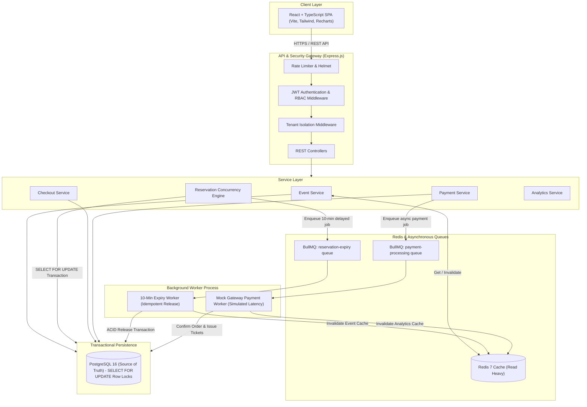
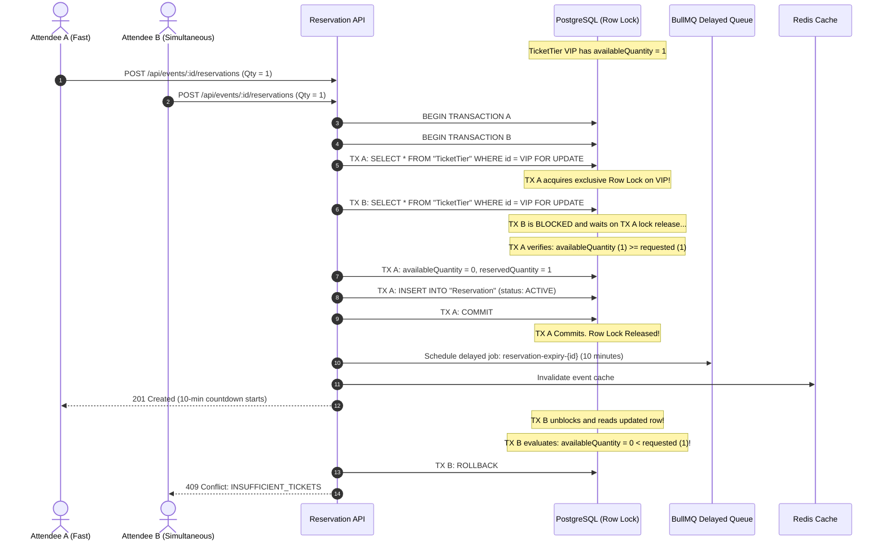
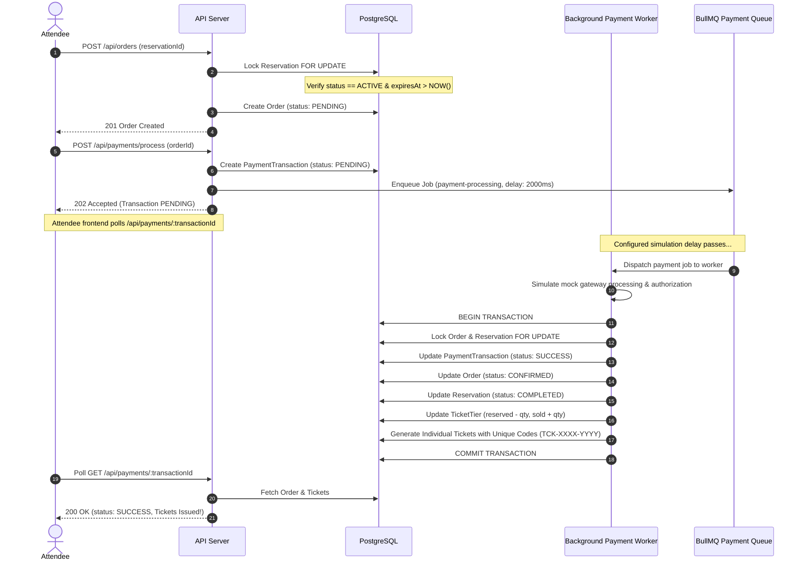

# System Architecture Documentation

This document describes the high-level architecture, multi-tenant isolation, concurrency control, 10-minute hold engine, and asynchronous mock payment processing in the **Multi-Tenant Event & Ticket Reservation System**.

---

## 1. High-Level Architecture Overview

The system follows a clean, decoupled n-tier architecture designed for horizontal scalability, zero-overselling inventory protection, and strict tenant partitioning.



---

## 2. Concurrency Protection Strategy

Under high-traffic situations (e.g., flash sales, celebrity concerts), multiple attendees frequently attempt to reserve the final available tickets at the exact same millisecond. 

### Why Frontend Checks & Stale Redis Inventory Fail
- **Frontend checks** are purely visual and cannot be trusted.
- **Redis inventory caches** are subject to race conditions and eventual consistency lag unless complex distributed Lua lock orchestration is used.
- **Unprotected SQL** (`SELECT available_quantity ... UPDATE ...`) produces dirty reads and catastrophic overselling under concurrent transactions.

### The PostgreSQL `SELECT FOR UPDATE` Row Locking Solution
The system establishes **PostgreSQL as the single source of truth** for all inventory mutations.

1. **Deadlock-Free Lock Ordering**: When a reservation hold contains multiple ticket tiers, the IDs are sorted lexicographically before acquiring locks:
   $$\text{sortedTierIds} = \text{tiers.sort}((a, b) \Rightarrow a.\text{id.localeCompare}(b.\text{id}))$$
2. **Row-Level Mutex**: The database transaction starts with:
   ```sql
   BEGIN;
   SELECT id, "availableQuantity", "reservedQuantity", price
   FROM "TicketTier"
   WHERE id = $1 AND "eventId" = $2
   FOR UPDATE;
   ```
3. **Pessimistic Invariant Verification**: Because `FOR UPDATE` serializes concurrent transactions requesting the same row, subsequent transactions are blocked until the lock-holding transaction commits.
4. **Atomic Decrement**:
   - If $\text{availableQuantity} \ge \text{requestedQuantity}$:
     ```sql
     UPDATE "TicketTier"
     SET "availableQuantity" = "availableQuantity" - $qty,
         "reservedQuantity" = "reservedQuantity" + $qty,
         "updatedAt" = NOW()
     WHERE id = $1;
     ```
     Inserts `Reservation` and `ReservationItem`, schedules BullMQ delayed expiration job, and commits.
   - If $\text{availableQuantity} < \text{requestedQuantity}$:
     Immediately rolls back with `AppError.insufficientTickets(...)`.

---

## 3. Sequence Diagram: Concurrent Reservation Race Condition

The following sequence diagram details how two attendees competing for the final remaining ticket are handled:



---

## 4. Sequence Diagram: Reservation → Checkout → Payment → Ticket Issuance



---

## 5. Multi-Tenant Isolation Model

1. **Logical Tenant Scoping**:
   - Each organizer is mapped to a tenant row in the `Organizer` table with a unique `ownerUserId`.
   - All events, ticket tiers, orders, and analytics derive their tenant ownership from `Event.organizerId`.
2. **Server-Side Enforcement**:
   - The `requireTenantEventOwnership` middleware inspects every incoming route mutating or querying private event data.
   - If `req.user.organizerId !== event.organizerId` (and the user is not `ADMIN`), the request is rejected with `403 Forbidden` (`TENANT_VIOLATION`).
3. **Database Level Scoping**:
   - Organizer queries automatically append `WHERE event.organizerId = req.user.organizerId`.
   - Modifying an ID in the URL parameter strictly fails server-side.
