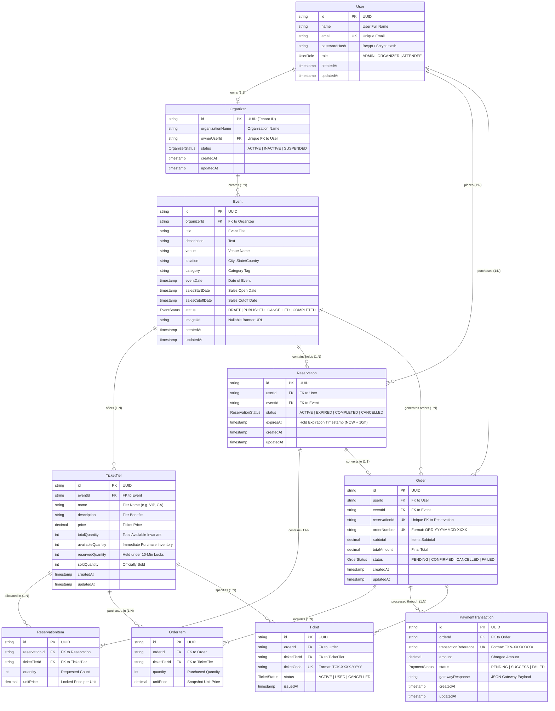

# Database Entity-Relationship (ER) Diagram

This document specifies the relational database schema, integrity constraints, indexes, and entity-relationship models for the **Multi-Tenant Event & Ticket Reservation System**.

---

## 1. Relational ER Diagram

---

## 2. Inventory Invariants & Integrity Constraints

1. **Total Inventory Conservation Formula**:
   $$\text{totalQuantity} = \text{availableQuantity} + \text{reservedQuantity} + \text{soldQuantity}$$
   At no point can this equation be violated.

2. **Non-Negativity Constraint**:
   $$\text{availableQuantity} \ge 0, \quad \text{reservedQuantity} \ge 0, \quad \text{soldQuantity} \ge 0$$
   Enforced via PostgreSQL `CHECK` constraints and `SELECT ... FOR UPDATE` row locking.

3. **Multi-Tenant Scoping**:
   Every event belongs strictly to an `organizerId`. Ticket tiers, reservations, and orders inherit tenant isolation from their corresponding `Event.organizerId`.

4. **10-Minute Hold Expiration Constraint**:
   If $\text{status} = \text{'ACTIVE'}$ and $\text{NOW}() > \text{expiresAt}$, the reservation cannot be converted into an order. Background BullMQ workers execute idempotent releases to restore inventory.

---

## 3. Database Indexes

| Table | Index Columns | Purpose |
| :--- | :--- | :--- |
| `User` | `email` (UNIQUE) | Fast user lookups during authentication |
| `User` | `role` | Role-based queries |
| `Organizer` | `ownerUserId` (UNIQUE) | Tenant ownership mapping |
| `Organizer` | `status` | Tenant activation filtering |
| `Event` | `organizerId` | Fast tenant isolation filtering |
| `Event` | `status`, `eventDate` | Fast public event discovery |
| `TicketTier` | `eventId` | Rapid inventory lookups per event |
| `Reservation` | `userId`, `eventId` | Attendee reservation listing |
| `Reservation` | `status`, `expiresAt` | Worker expiration sweep index |
| `Order` | `userId`, `eventId` | Attendee and Organizer order queries |
| `Order` | `orderNumber` (UNIQUE) | Receipt and tracking lookups |
| `Order` | `reservationId` (UNIQUE) | One-to-one order checkout constraint |
| `PaymentTransaction` | `orderId`, `transactionReference` (UNIQUE) | Gateway reconciliation lookups |
| `Ticket` | `ticketCode` (UNIQUE) | QR/Barcode entry scanning verification |
